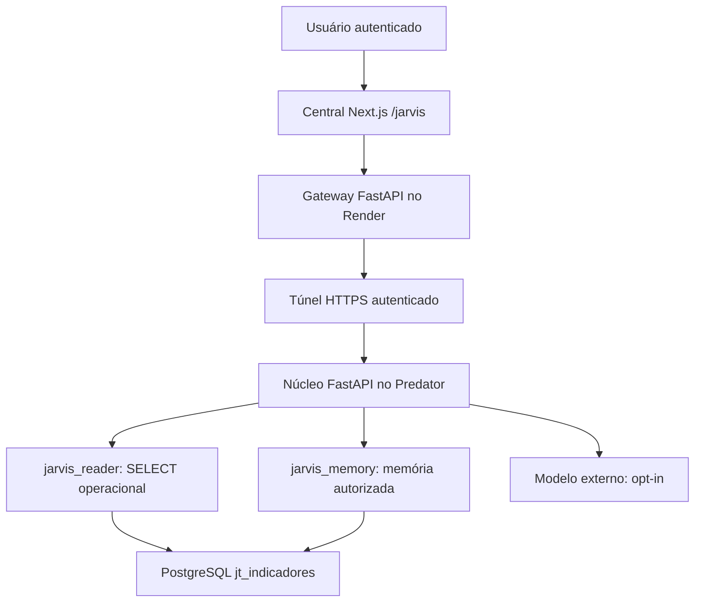

# Arquitetura e decisões

Na primeira fase, o backend é dividido entre um gateway no Render e o núcleo na VM. Evita-se criar uma API remota que aceite SQL arbitrário ou tenha uma credencial administrativa. O gateway repassa somente rotas fixas, preserva a identidade do usuário e acrescenta uma credencial entre serviços. TLS é verificado e redirecionamentos são recusados.

O núcleo executa consultas fixas parametrizadas em transações READ ONLY, com timeout e limite de linhas. A LLM pode propor somente filtros validados. As tabelas operacionais não recebem INSERT, UPDATE, DELETE ou DDL. O papel de memória grava apenas nas tabelas autorizadas; histórico de revisões e auditoria são append-only para ele.

`jarvis.base_assignments` é o contrato de gestão por código e vigência. O importador não assume que a gestão atual sempre valeu no passado. A gestão precisa ser completa e documentada para cada período aprovado. Fontes com código textual precisam ser normalizadas na origem; não se remove zero à esquerda automaticamente. Em Qualidade, `base_chave` passa pelo mapeamento de código em `jt_1bd_gestao`; é preciso validar unicidade e estabilidade desse código. O gestor histórico vem exclusivamente das vigências.

As tabelas `memories` representam ocorrências, hipóteses e causas atribuídas ao gestor por estado. Evidências, ações e métricas ficam nos respectivos campos; não há tabelas artificiais vazias para cada substantivo. `memory_revisions` guarda snapshots anteriores, autor e motivo. `investigations.result` guarda texto e fontes externas. Embeddings, evidências normalizadas e retenção automática serão migrations futuras.

A memória de produção exige PostgreSQL. SQLite é só um modo de desenvolvimento para permitir testar sem acesso à VM. Não existe fallback automático de PostgreSQL para SQLite em falhas, evitando memórias fragmentadas.

Limites conhecidos: chave individual estática, sem SSO ou MFA próprios; controle de taxa em memória por processo; paginação limitada; sem streaming da resposta; busca lexical; confirmação de causa é relato atribuído ao gestor. Para escalar, adicionar sessões revogáveis/SSO, limite distribuído e paginação por cursor. Nenhuma alegação de resistência absoluta a prompt injection: a proteção principal são permissões e ausência de execução de código/SQL pelo modelo.
